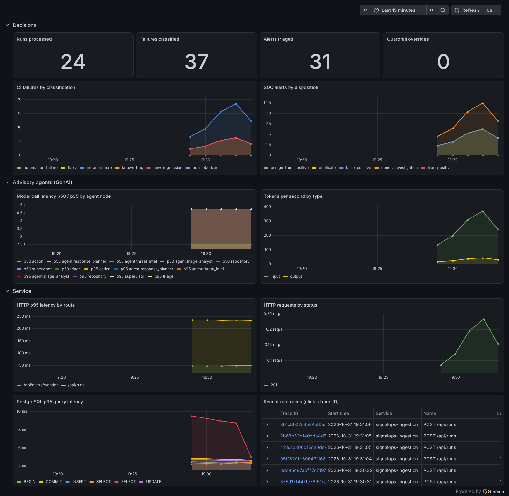

# Observability: OpenTelemetry, Tempo, Prometheus and Grafana

The ingestion service and the investigation worker export **traces and metrics over OTLP** with
the OpenTelemetry Node SDK. Locally they go to `grafana/otel-lgtm`, a single open-source
container with an OpenTelemetry Collector, Tempo, Prometheus, Loki and Grafana. No account and
no cost. It is a development image, not a production deployment.

Telemetry is **off by default** (`OTEL_ENABLED=false`): no SDK, no exporter and no overhead.
The database audit tables (`agent_model_calls`, `agent_execution_events`) are written either
way. OpenTelemetry is an export path for the same signals, not a replacement for the audit
trail.

## Run it

```bash
docker compose -f docker-compose.yml -f docker-compose.observability.yml up --build -d
npm run demo:observability     # sends a run, then asserts the trace, the metrics and the dashboard
```

Open <http://localhost:3000>, then **Dashboards → SignalOps → SignalOps**, or **Explore → Tempo**
with `{ name = "signalops.process_run" }`.

GenAI spans need an agent run. Without a local Ollama, the deterministic demo stub exercises the
wiring:

```bash
COMPOSE_PROFILES=demo-stub AI_ENABLED=true OLLAMA_HOST=http://ollama-stub:11434 \
  docker compose -f docker-compose.yml -f docker-compose.observability.yml up --build -d
EXPECT_GENAI=true npm run demo:observability
```

The stub is not inference: its latencies and token counts mean nothing. Model latency and cost
for a real model are in the [benchmark](../benchmark/README.md).



_The GenAI panels in this screenshot are fed by the deterministic demo stub, not a real model._

## What a run trace looks like

```text
POST /api/runs                                   (HTTP server span)
└─ signalops.process_run      run_id, repository, environment, tests, duplicate, failures
   ├─ pg.query:SELECT / INSERT                   (PostgreSQL)
   └─ signalops.process_test  test_id, fingerprint (12 chars), classification,
      │                       agent.recommended_action, approval_pending, jira_key
      ├─ chat <model>         gen_ai.* attributes, agent node, prompt version  (one per model call)
      ├─ POST                 outgoing fetch: Ollama, Jira, Slack, enrichment (undici)
      └─ pg.query:...
```

A guardrail override adds a `guardrail_override` event to the active span, with the replaced
action and the reason.

## Metrics

| Metric (Prometheus name)                    | Type      | Labels                                                     |
| ------------------------------------------- | --------- | ---------------------------------------------------------- |
| `signalops_runs_processed_total`            | counter   | `signalops_duplicate`                                      |
| `signalops_failures_classified_total`       | counter   | `signalops_classification`, `signalops_approval_pending`   |
| `signalops_alerts_triaged_total`            | counter   | `signalops_disposition`, `signalops_vendor`                |
| `signalops_agent_guardrail_overrides_total` | counter   | `signalops_reason`                                         |
| `gen_ai_client_operation_duration_seconds`  | histogram | `gen_ai_request_model`, `signalops_agent_node`             |
| `gen_ai_client_token_usage`                 | histogram | `gen_ai_request_model`, `gen_ai_token_type` (input/output) |
| `http_server_request_duration_seconds`      | histogram | `http_route`, `http_response_status_code` (auto)           |
| `db_client_operation_duration_seconds`      | histogram | `db_operation_name` (auto)                                 |

GenAI names follow the OpenTelemetry GenAI semantic conventions. Every known counter series
starts at 0 when the service boots, so Prometheus `increase()` does not miss the first event of
a series.

## Design choices

- **API-only domain code.** `observability/telemetry.ts` uses only `@opentelemetry/api`, so every
  call is a no-op without the SDK and unit tests need no exporter. `observability/register.ts`
  starts the SDK and must be imported first in each entry point, so HTTP, Express and pg are
  instrumented.
- **One hook for model calls.** Every graph (single agent, supervisor, SOC) already reports
  through the telemetry sink, which now also emits the GenAI span and histograms. The span is
  recorded from the measured duration after the call returns.
- **No content in telemetry.** Attributes are identifiers and decisions. Error messages,
  prompts and model output are never exported, because they can contain customer data. Exceptions
  record only the error class.
- **Low cardinality.** Metric labels are fixed enumerations. Per-run identifiers live on spans
  only.
- **Noise control.** `/health` requests are not traced. PostgreSQL spans are only recorded inside
  a traced operation, so startup migrations do not create orphan traces.

## Evidence

- `observability.test.ts`: span names, GenAI attributes, parent-child nesting, histogram export,
  counter initialization, and that an error message never reaches an exported span.
- CI job **OpenTelemetry traces and metrics (Grafana LGTM)** starts the stack with the demo stub
  and runs `npm run demo:observability` with `EXPECT_GENAI=true`. It asserts the full trace tree
  in Tempo, the metrics in Prometheus and the provisioned dashboard in Grafana.

## Configuration

| Variable                      | Default               | Purpose                                      |
| ----------------------------- | --------------------- | -------------------------------------------- |
| `OTEL_ENABLED`                | `false`               | Start the OpenTelemetry SDK                  |
| `OTEL_SERVICE_NAME`           | `signalops-ingestion` | `service.name` resource attribute            |
| `OTEL_EXPORTER_OTLP_ENDPOINT` | SDK default           | OTLP/HTTP endpoint (`http://otel-lgtm:4318`) |
| `OTEL_METRIC_EXPORT_INTERVAL` | `10000`               | Metric export interval in ms                 |

Standard `OTEL_*` SDK variables (headers, sampling, resource attributes) also apply.

## Not covered

- Logs are still written to stdout. They are not exported over OTLP or correlated with trace IDs.
- No production collector, sampling policy or retention is configured. On AWS, the same OTLP
  export would go to an ADOT collector feeding X-Ray and CloudWatch; that is not in the
  Terraform yet.
- The dashboard has no alert rules.
